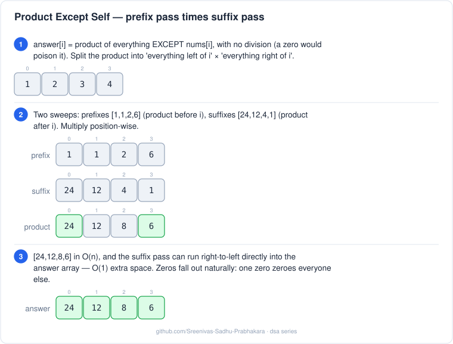

# Product of Array Except Self

> NeetCode 150 · Arrays & Hashing · Blind 75 — answer[i] = (product left of i) × (product right of i); two sweeps, the output array doubling as scratch. Go, stdlib only, tested.

## Problem

For each index, the product of all *other* elements — division forbidden (the divide-total-by-self trick dies on zeros anyway, which the `[−1,1,0,−3,3]` test demonstrates).

## Approach

Split each answer at its own index: everything to the left times everything to the right. A forward sweep writes the running prefix product *before* multiplying in the current element (so index i sees products of 0..i−1); a backward sweep symmetrically multiplies in the running suffix. Writing prefixes directly into the output and carrying the suffix in a scalar gets O(1) extra space — the output doesn't count, per the classic constraint. Zeros need no special-casing: they propagate correctly through both sweeps, one zero zeroing everyone else, two zeros zeroing everything.

**Complexity:** O(n) time, O(1) extra space.

## Visual walkthrough

Read the picture top to bottom — each numbered frame is one moment of the algorithm
running on this repo's test example.

## Run

    go test ./...   # verify
    go run .        # demo

---

Part of a 275-repo DSA series in Go — Striver's SDE Sheet (dsa-001–191) plus the NeetCode 150 / Blind 75 additions (dsa-192–275), stdlib only, every solution tested. Browse: [`dsa-*` repos](https://github.com/Sreenivas-Sadhu-Prabhakara?tab=repositories&q=dsa-&type=source).
